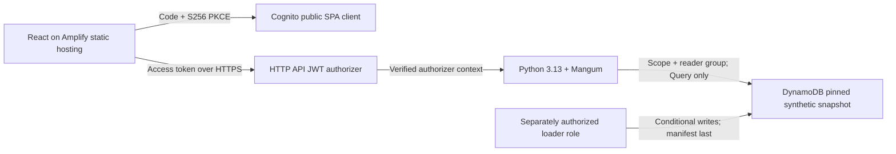

# Phase 4A — secure single-account deployment foundation

Status: source and offline validation only. Nothing has been deployed, seeded, connected to GitHub/Amplify, or discovered in AWS. No credentials, AWS API calls, real account IDs, Terraform apply/destroy, commits, or pushes are authorized by this phase.

## Scope and architecture

All future resources target **one explicitly supplied personal account in eu-central-1**. This is application infrastructure, not an enterprise landing zone. The ten displayed accounts, findings, drift, deployments, and exceptions stay synthetic. No Organizations, Control Tower, AFT, VPC, NAT Gateway, Transit Gateway, firewall, public write API, Cognito identity pool, or browser AWS credentials are included.



`terraform/poc/` is the isolated deployable root. Reusable POC modules are `poc_identity`, `poc_data`, `poc_compute`, `poc_http_api`, and `poc_hosting`. Enterprise references remain outside this graph. Terraform variables supply the account, resource prefix, owner, Cognito domain prefix, optional existing role boundary, concurrency, and artifact path. Frankfurt is fixed. Provider `allowed_account_ids` prevents accidental deployment to another account when a later authorized provider operation verifies the caller; no discovery data sources are used.

Terraform 1.14.6 was used locally; constraints are >=1.14,<2. AWS provider 6.71.0 is signed and locked; root constraints permit only 6.71 patches, while module constraints permit compatible 6.x updates. Review upgrades and the lockfile diff explicitly. `init -backend=false` downloads public registry plugins and never initializes AWS state. Schema validation and mock-provider test plans perform no AWS operations. A normal plan is **not** offline and is not authorized now.

## Identity, trust, and permissions

The SPA uses `oidc-client-ts` Authorization Code flow with PKCE enabled (S256), state/nonce handling and code exchange. No client secret exists. Tokens stay in memory; PKCE transaction state is temporarily stored in sessionStorage by the library. Reloads require sign-in again (the Cognito browser session can reduce repeated prompts). There is no silent renewal, browser AWS SDK, or direct DynamoDB access. The production entry point fails closed if public Cognito/API configuration is missing or `local` mode is requested. `npm run dev` still defaults to the existing loopback-only local demo.

Cognito uses Lite/classic hosted UI, admin-created users only, required TOTP MFA, password policy, a public code-only app client, custom `northstar-governance/read` scope, a ten-minute access-token lifetime, and an initially empty `governance-readers` group. No users, passwords, invitations, MFA secrets, or group assignments are provisioned. A separately authorized operator must invite a viewer, complete verification/MFA, and explicitly grant the group. Default Cognito email delivery quotas and domain-prefix availability must be checked during authorized deployment, not assumed from offline tests.

Cognito supports S256 PKCE but does not expose a user-pool-client setting that universally mandates a challenge. The application always sends one; do not claim Terraform enforces PKCE for every possible client request. The app disables implicit/password/client-credentials flows for its use and does not expose a fake JWT verifier.

All eight GET routes, including health, require the HTTP API JWT authorizer and read scope. API Gateway verifies signature, issuer, audience/client binding and token validity. The Lambda layer then requires the configured API ID/stage, an AWS Lambda context, access-token use, matching issuer/client ID, a subject, read scope, and reader-group membership from `requestContext.authorizer.jwt.claims`. Plain HTTP headers cannot establish that trusted scope. Group claim string/list forms are normalized only after the verified-context boundary.

The deployed Mangum adapter strips the fixed `/poc` prefix when present in the HTTP API event path; the stage is still checked independently in the trusted context. Offline handler tests exercise both stage-prefixed and integration-relative paths. Actual gateway routing and claim serialization remain deployment acceptance gates.

This trust model depends on **IAM invocation isolation**: no function URL, no unauthenticated invoke, and a resource permission restricted to this gateway/account/stage/GET path. Browser users have no IAM credentials. Principals with direct Lambda invoke permission can forge event context; therefore future CI/runtime/operator IAM must not grant direct invoke to untrusted callers. An account administrator can change these protections and is outside this boundary. The application does not independently cryptographically reverify a JWT; it consumes the gateway's verified result, never an unverified Authorization header.

Gateway CORS allows only the specific Amplify branch origin, GET/OPTIONS, and Authorization/Content-Type. Automatic unauthenticated preflight is a browser protocol response, not a data route. Write methods and arbitrary paths have no integration. Cross-origin cookies are not used. Sign-out clears tokens and query caches and ends the Cognito browser session; group removal or logout does not instantly revoke an already issued token at the HTTP JWT authorizer. The ten-minute lifetime bounds that delay; immediate revocation would require a separately designed mechanism.

## DynamoDB snapshot model and loading

DynamoDB uses on-demand capacity, encryption with the AWS-managed DynamoDB key, PITR, deletion protection, and a Terraform prevent-destroy guard. CloudWatch log groups use service-provided encryption and bounded retention (14 days by default). No customer-managed KMS keys or additional key charges are introduced by this design. Public data access is absent.

The repository interface is unchanged. The deployed adapter performs strongly consistent, paginated Query calls for one `SNAPSHOT#<sha256>` partition. Each record is a small JSON payload item; ordered collection keys preserve the model's list order. A manifest records the digest, provenance and item count. The adapter validates the complete snapshot and digest before calling the existing Phase 1 evaluator. Missing, partial, corrupted or unseeded data fails closed; there is no fixture fallback. All evaluation still uses the explicit/fixed reference timestamp and preserves unknown/stale results and exceptions.

The current manifest describes 78 payload items plus one publication marker. A new fixture/policy version yields a new immutable partition and a reviewed Lambda snapshot configuration change, not a mutable active pointer. Reads never need Scan, GetItem, writes, or table-wide access. IAM restricts the runtime to Query on the exact table and leading partition key. This small-fleet snapshot model is deliberately not a fleet-scale query/index design.

Offline preparation is safe now:

```sh
.venv/bin/python -m scripts.seed_governance
```

It only writes ignored `artifacts/seed/snapshot.json`, validates the ten-account distribution and records, and prints the content digest. It does not create an SDK client. `mock-data/snapshot.v1.manifest.json` pins the root's expected digest; tests reject drift between the manifest and source fixtures.

Only **after separate deployment and data-loading authorization**, use the short-lived table-specific loader policy exported as `seed_iam_policy`, not the runtime role. The loader's execution form is `python -m scripts.seed_governance --execute --table-name TABLE --confirm-table TABLE`. Do not run it in Phase 4A. It conditionally inserts each immutable row, accepts only byte-identical rows on retry, and publishes the manifest last. SDK retries are bounded; failed/partial runs can be safely retried. A conflicting row stops the load without overwriting. The role can technically issue other PutItem requests in that partition; immutability is code-enforced and tampering is digest-detected, not a DynamoDB WORM guarantee. Remove loader access after verification. No seed data is managed by Terraform or an API write endpoint.

## Offline packaging and frontend configuration

Build the Lambda package from Linux ARM64 Python 3.13 wheels, not the macOS `.venv`. Public PyPI downloads do not access AWS. After dependencies have been downloaded, assembly is fully offline:

```sh
.venv/bin/python -m pip download --platform manylinux2014_aarch64 --implementation cp \
  --python-version 3.13 --abi cp313 --only-binary=:all: \
  -r backend/requirements.txt --dest artifacts/lambda/wheels
.venv/bin/python -m pip install --no-index --find-links artifacts/lambda/wheels \
  --platform manylinux2014_aarch64 --implementation cp --python-version 3.13 --abi cp313 \
  --only-binary=:all: --target artifacts/lambda/vendor -r backend/requirements.txt
.venv/bin/python -m scripts.package_lambda
```

Use a fresh vendor directory for dependency changes to avoid retaining stale files. The packager requires the complete exact runtime dependency/version set, checks wheel architecture, rejects symlinks, fixes archive timestamps/order, includes a per-file hash manifest, and excludes fixtures, tests, Terraform, local environments and credentials. It includes the model schema and Python modules; deployed data must come from DynamoDB. Terraform hashes this local artifact and contains no build/seed provisioners. Rebuild after any source/dependency change. Linux wheel availability, ZIP integrity and mock events are checked offline; real Lambda imports/integration remain unverified until authorized cloud testing.

`frontend_settings` outputs public `VITE_AUTH_MODE`, API base URL (including `/poc`), Cognito issuer/client/domain, and SPA origin. These are deployment configuration, not credentials. There is no reliance on the local Vite proxy in a hosted build. Cognito callback is exactly `<origin>/auth/callback`; logout is `<origin>/`.

After a future authorized deployment, save the **named** `frontend_settings` Terraform output as plain JSON (not the entire state/output wrapper). Then the following command only transforms that saved local file:

```sh
.venv/bin/python -m scripts.frontend_config --input artifacts/frontend-settings.json
npm --prefix frontend run build
```

The transformer rejects unknown/secret fields and writes ignored `frontend/.env.production.local`. Vite bakes public values into the build. Do not commit that generated environment file. Without deployed settings, the production bundle still compiles but shows a configuration-required screen and makes no API calls. `npm run dev` remains the supported local-demo flow. Existing static-preview instructions from Phase 3 now require production Cognito settings; there is no production local-demo bypass.

## Amplify hosting and repository connection

The Terraform app/branch prepares manual static hosting with no repository token and auto-build disabled. An initial approved static ZIP deployment can use the compiled `frontend/dist` contents. No artifact upload or deployment job is started here. Branch variables alone cannot configure a prebuilt ZIP: generate/bake the public settings before building it.

`amplify.yml` is a future monorepo build specification, **not an executable GitHub deployment workflow**. The branch configuration includes `AMPLIFY_MONOREPO_APP_ROOT=frontend`; the build installs Node 24, locked npm dependencies, checks types/lint/tests, and builds `dist`. The root/SPA rewrite handles callback and client routes; security headers include no-referrer, HSTS, nosniff, frame denial and a regional Cognito/API CSP. Inline styles are intentionally permitted for React's dynamic chart styles; scripts remain same-origin.

The frontend test setup explicitly selects local mode for each isolated test; authentication tests override it. This prevents Amplify's production environment variables from changing fixture tests or requiring a real sign-in during builds. That setup is test-only and is excluded from the production bundle; production configuration still requires Cognito. The same suite is checked locally with nonfunctional Cognito/API build variables present.

Creating a repository-connected Amplify app through the provider requires source-provider authorization (the resource supports token fields). This implementation intentionally does not put such a token in variables/state. A later authorized operator must connect/install the narrowly scoped Amplify GitHub App through the supported console/service flow. Changing an existing manual app's repository may require an authenticated UpdateApp flow or a replacement/import; confirm the actual service path before proceeding. Do not invent a token-free Terraform repository connection. The app ignores repository drift solely to avoid severing that operator-managed connection; document/import its ownership deliberately. If a replacement changes the app domain, update Cognito callbacks, API CORS, frontend origin and build settings together. Keep auto-build disabled until branch selection, approval and frontend-only deployment behavior are reviewed.

## Terraform state bootstrap and future delivery

The POC root declares a partial S3 backend; the bucket does **not** bootstrap itself. Before any remote initialization, a separately authorized operator must establish a private Frankfurt bucket with versioning, encryption, Public Access Block, TLS-only bucket policy, and least-privilege access. Verify the backend bucket's account/ownership separately: the application provider's account guard does not constrain the S3 backend. Scope ListBucket to the needed prefixes, Get/Put to the state object, and Get/Put/Delete to its lock object; state deletion permission is not needed for normal operation. Prefer dedicated state permissions and a customer-managed KMS key only if the extra IAM/cost/rotation requirements are accepted. Keep state separate from application data and enterprise reference state. Protect state backups and never publish them as CI artifacts.

`backend.hcl.example` uses `encrypt=true` and native S3 `use_lockfile=true`; no deprecated DynamoDB state-lock table is added. Supply a real backend bucket/account only after explicit authorization. State migration, initialization against S3, normal plans/refresh, apply and destroy are cloud operations and are not authorized by this document. Local validation uses `-backend=false` exclusively.

Future GitHub Actions OIDC should use a dedicated GitHub environment with required reviewers, `id-token: write` only for deployment jobs, audience `sts.amazonaws.com`, and exact repository/environment `sub` trust. Avoid PR/fork credentials, broad branch wildcards, long-lived keys, and direct Lambda invoke authority. Separate validation from privileged plan/apply; require a revision-bound reviewed plan, serialized state access and short artifact retention. Restrict deployment actions to this POC's named/tagged resources, IAM PassRole only to its Lambda role with service conditions, exact state keys, and approved permissions boundaries. IAM create/update/bootstrap permissions need a separate concrete review before granting; no broad deploy role or OIDC provider is created now. Amplify repository builds deploy frontend assets only, not Terraform or the loader. No executable GitHub Actions deployment workflow exists.

## Cost controls, operations and teardown

Low-cost defaults are HTTP API (not REST), ARM64/256 MB Lambda, 20-second timeout, reserved concurrency 2, gateway throttle 5 requests/s with burst 10, on-demand DynamoDB, small immutable data, Lite Cognito/TOTP, static Amplify hosting, and 14-day logs. A new personal account may lack sufficient regional Lambda concurrency quota to reserve 2 while retaining AWS's required unreserved pool. Check that only after authorization; request quota or consciously select the documented `-1` opt-out rather than claiming offline validation proves quota availability.

Costs include API requests (including some denied traffic), Lambda requests/GB-seconds, DynamoDB reads/writes/storage/PITR, CloudWatch ingestion/storage, Cognito MAUs/email delivery, Amplify builds/storage/transfer, and S3 state/version storage. Encryption does not make these services free. As an illustrative workload, 1,000 dashboard refreshes cause about 6,000 API calls plus details, repeated partition queries and evaluation; use the actual snapshot item sizes to estimate read units. Multiply those quantities by current Frankfurt service rates and include every retained snapshot/version. No fixed invoice or free-tier entitlement is promised. Before deployment, set an operator-approved budget/alerts and review billing during demos; throttles are not a hard spend cap.

Use [AWS Pricing Calculator](https://calculator.aws/), [API Gateway pricing](https://aws.amazon.com/api-gateway/pricing/), [Lambda pricing](https://aws.amazon.com/lambda/pricing/), [DynamoDB pricing](https://aws.amazon.com/dynamodb/pricing/), [CloudWatch pricing](https://aws.amazon.com/cloudwatch/pricing/), [Cognito pricing](https://aws.amazon.com/cognito/pricing/) and [Amplify pricing](https://aws.amazon.com/amplify/pricing/) for account-specific rates and credits. Do not enable SMS, dedicated networking, provisioned concurrency or extra KMS keys by assumption.

For recovery, preserve the immutable fixture inputs/digest, rebuild a reviewed artifact, retry interrupted seed loads, and select a known-good snapshot through reviewed Terraform configuration. PITR is a future restore workflow, not an automatic recovery action. Logs deliberately exclude tokens/claims, bodies, user emails and query strings. No alarms, WAF, high-availability regional failover or durable security audit pipeline is implemented; HTTP API endpoints are public network addresses protected by authentication, not private VPC endpoints. The public static SPA contains no governance data or secrets and is safe to serve before sign-in; only API data is protected.

Teardown requires separate explicit authorization and a reviewed destroy plan. First disable frontend builds/traffic and revoke temporary loader/CI access; export needed synthetic evidence/state and choose retention. The Cognito pool and DynamoDB table have both service deletion protection and Terraform prevent-destroy guards. Authorized teardown must deliberately remove the lifecycle guards and disable service protection in reviewed steps before destruction; do not bypass them silently. Remove the Amplify branch/app, API, Lambda, IAM role/policy and logs according to retention needs; handle retained backups/snapshots explicitly. Keep the private state bucket until all application resources and recovery requirements are resolved. No teardown commands were executed.

## Offline acceptance checks

```sh
.venv/bin/python -m unittest discover -s tests -v
.venv/bin/ruff check backend governance scripts tests
.venv/bin/ruff format --check backend governance scripts tests
.venv/bin/python -m compileall -q backend governance scripts tests
.venv/bin/python -m pip check
terraform fmt -check -recursive terraform
terraform -chdir=terraform/poc init -backend=false -input=false
terraform -chdir=terraform/poc validate
# Requires the local artifact, mock_provider aws, and command=plan only:
terraform -chdir=terraform/poc test
npm --prefix frontend run api:check
npm --prefix frontend run typecheck
npm --prefix frontend run lint
npm --prefix frontend run format:check
npm --prefix frontend test
npm --prefix frontend run build
git diff --check
```

SDK test clients are injected/blocked. OIDC tests mock the client library and never contact Cognito; they verify configuration, callback denial/success, memory tokens, missing-session denial and deployed URL/header construction. Terraform tests mock the provider and have no apply runs. Packaging tests check reproducibility and reject macOS wheels. These checks do not prove real service quotas, callback/MFA UX, gateway claim serialization, GitHub authorization, deployment IAM, Linux execution or costs in the actual account. Those are explicit acceptance gates for a later authorized deployment. See [the adversarial review](AWS_DEPLOYMENT_REVIEW.md) for findings and the exact proposed resource inventory.

Sources: [HTTP API JWT authorizers](https://docs.aws.amazon.com/apigateway/latest/developerguide/http-api-jwt-authorizer.html), [Cognito authorization endpoint/PKCE](https://docs.aws.amazon.com/cognito/latest/developerguide/authorization-endpoint.html), [public SPA client guidance](https://docs.aws.amazon.com/cognito/latest/developerguide/user-pool-settings-client-apps.html), [manual Amplify deployments](https://docs.aws.amazon.com/amplify/latest/userguide/manual-deploys.html), [Amplify UpdateApp](https://docs.aws.amazon.com/amplify/latest/APIReference/API_UpdateApp.html), [AWS provider releases](https://releases.hashicorp.com/terraform-provider-aws/), [Lambda Python packaging](https://docs.aws.amazon.com/lambda/latest/dg/python-package.html).
